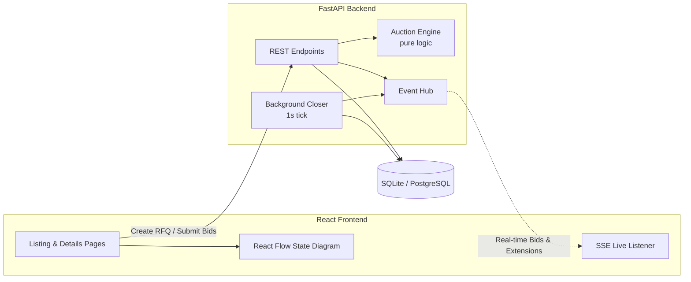

# British Auction RFQ System - Assignment Submission

This is my submission for the AI Engineer Internship assignment. It implements a simplified RFQ (Request for Quotation) system featuring **British Auction-style bidding**, where auctions automatically extend if competitive bidding occurs near the deadline, bounded by a strict forced close time.

---

## 🌐 Live Demo & Deployment Links

- **Live Frontend (Vercel)**: [https://british-auction-rfq.vercel.app](https://british-auction-rfq.vercel.app)
- **GitHub Repository**: [https://github.com/adityaa3pathi/British-Auction-RFQ](https://github.com/adityaa3pathi/British-Auction-RFQ)
- **Local Dev Server**: `http://localhost:5173` | **API Swagger Docs**: `http://localhost:8000/docs`

---

## 1. High-Level Design & Architecture

### System Flow Diagram



### Architecture Highlights
- **FastAPI Backend**: Chosen for native async support, fast development speed, and auto-generated API docs at `/docs`.
- **Pure Engine (`auction_engine.py`)**: All auction extension calculations are isolated into a pure Python function without database calls. This made writing unit tests straightforward.
- **Server-Authoritative Clock**: Deadlines and trigger windows are calculated using the server's UTC time to avoid client clock tampering.
- **Server-Sent Events (SSE)**: Instead of heavier WebSocket setups, SSE provides lightweight one-directional streaming so open browser tabs update automatically when a bid or extension occurs.
- **React Flow Visualizer**: Added an interactive diagram on the auction details page to visually show the bidding state machine.

---

## 2. Database Schema

The database consists of 5 tables:

| Table | Purpose |
|---|---|
| `rfqs` | Stores RFQ metadata, start time, dynamic close time, and hard forced close time. |
| `auction_configs` | Stores British Auction parameters: Trigger Window ($X$ min), Extension ($Y$ min), and Trigger rule. |
| `bids` | Stores supplier quotes: carrier name, freight, origin, and destination charges, transit days, and total price. |
| `suppliers` | Seeded suppliers for demo testing. |
| `auction_events` | Audit log of bid submissions, time extensions, and closures. |

---

## 3. How the British Auction Logic Works

1. **Trigger Window $[T_{close} - X, T_{close})$**:
   The engine only checks for extensions if a bid arrives in the final $X$ minutes before the current close time.

2. **Configurable Triggers**:
   - `BID_RECEIVED`: Extends the auction on any valid bid placed within the window.
   - `ANY_RANK_CHANGE`: Extends only if a supplier changes their relative rank.
   - `L1_RANK_CHANGE`: Extends only if a new bidder captures the lowest price (L1).

3. **Forced Close Ceiling**:
   Extensions calculate `new_close = min(current_close + Y, forced_close)`. If an extension would push past the forced close deadline, it caps exactly at the forced close time and marks the event as capped.

4. **Continuous Lowering Rule**:
   A supplier can submit multiple bids to compete, but each new bid must be strictly lower than their own prior bid.

---

## 4. Setup & Running Locally

### Prerequisites
- Python 3.10+
- Node.js 18+

### Quickstart (Single Command)
```bash
./start.sh
```
This runs the backend on `http://localhost:8000` (seeds initial data automatically) and the frontend on `http://localhost:5173`.

### Or Run Manually

**1. Backend:**
```bash
cd backend
python3 -m venv venv
source venv/bin/activate
pip install -r requirements.txt
python seed.py
uvicorn app.main:app --reload --port 8000
```

**2. Frontend:**
```bash
cd frontend
npm install
npm run dev
```

---

## 5. Running the Tests

To verify the British auction rules and edge cases:
```bash
cd backend
PYTHONPATH=. venv/bin/pytest tests/ -v
```

Tests cover:
- Bids arriving outside the trigger window (no extension).
- Unconditional extensions (`BID_RECEIVED`).
- L1 rank change extensions vs. non-L1 bids.
- Mid-table rank changes (`ANY_RANK_CHANGE`).
- Extensions hitting the forced close ceiling.
- Enforcing that new bids must be strictly lower than previous bids.
